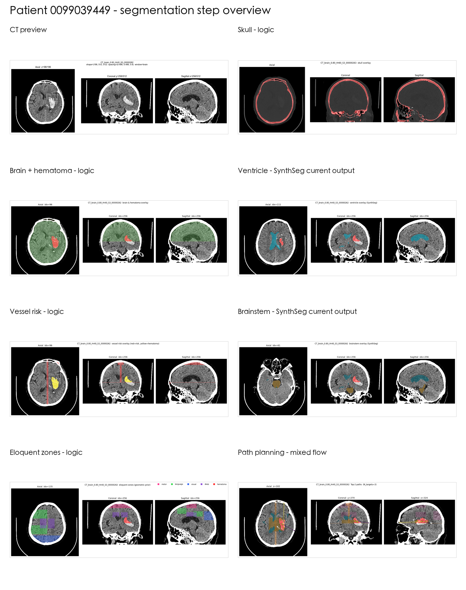
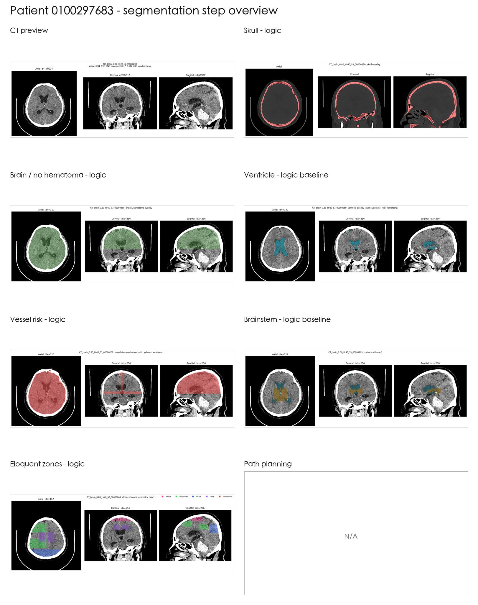
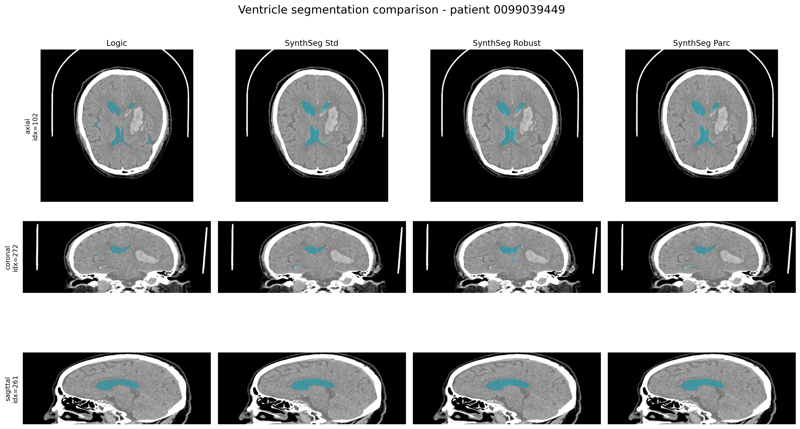
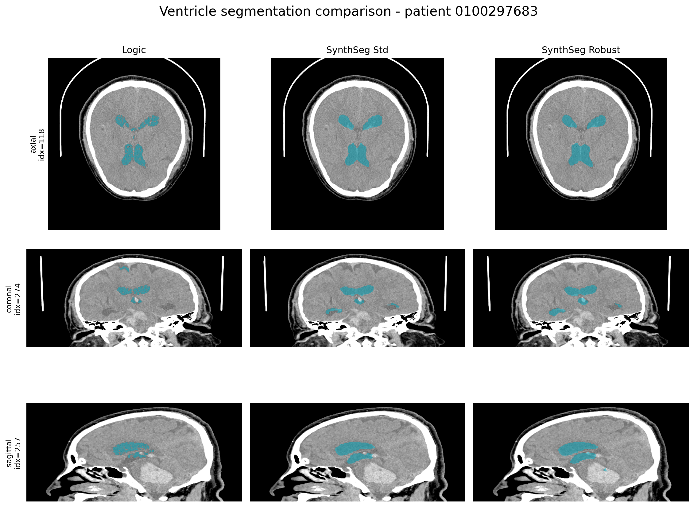
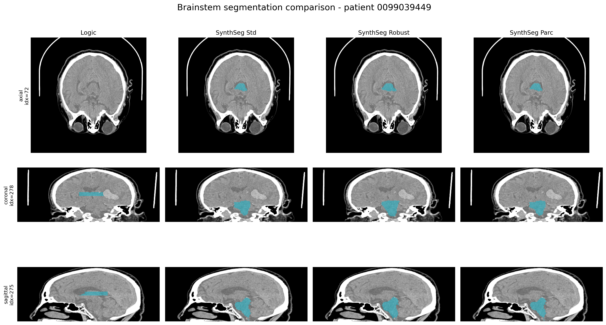
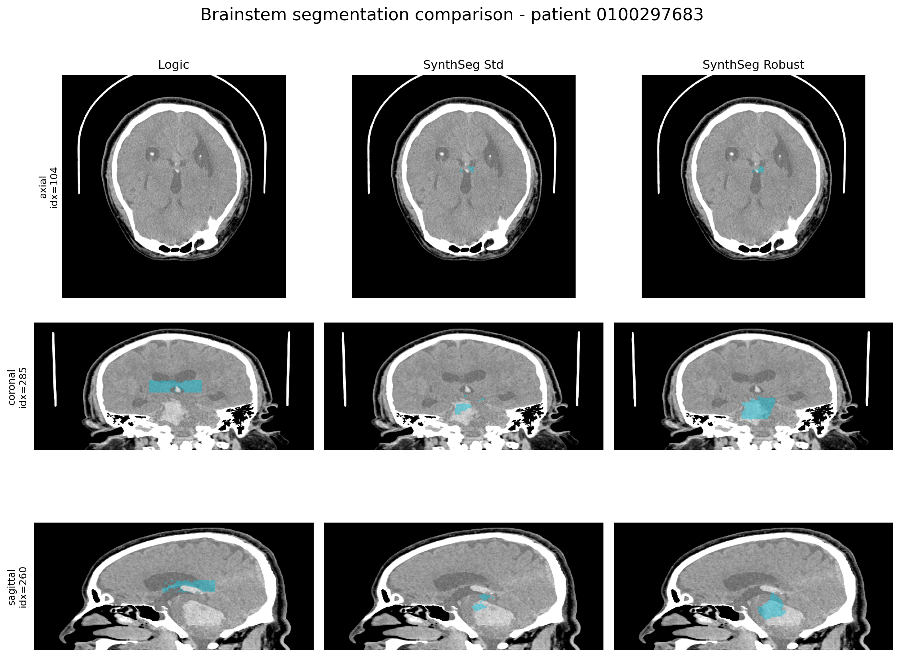
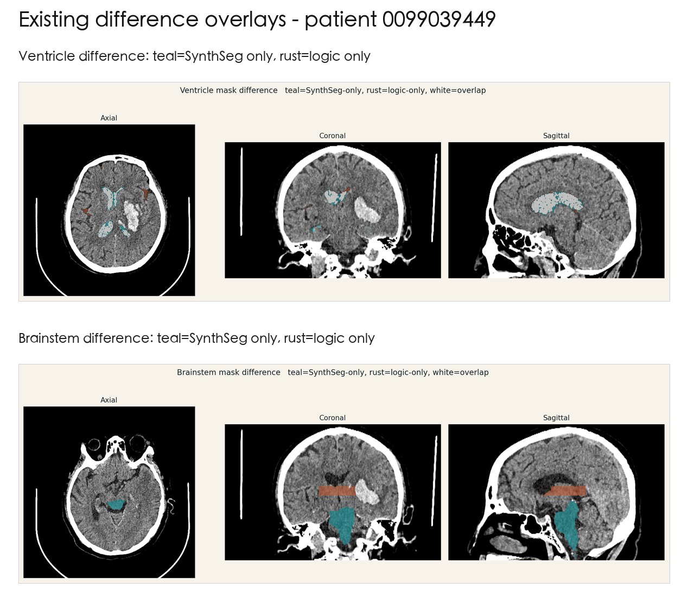
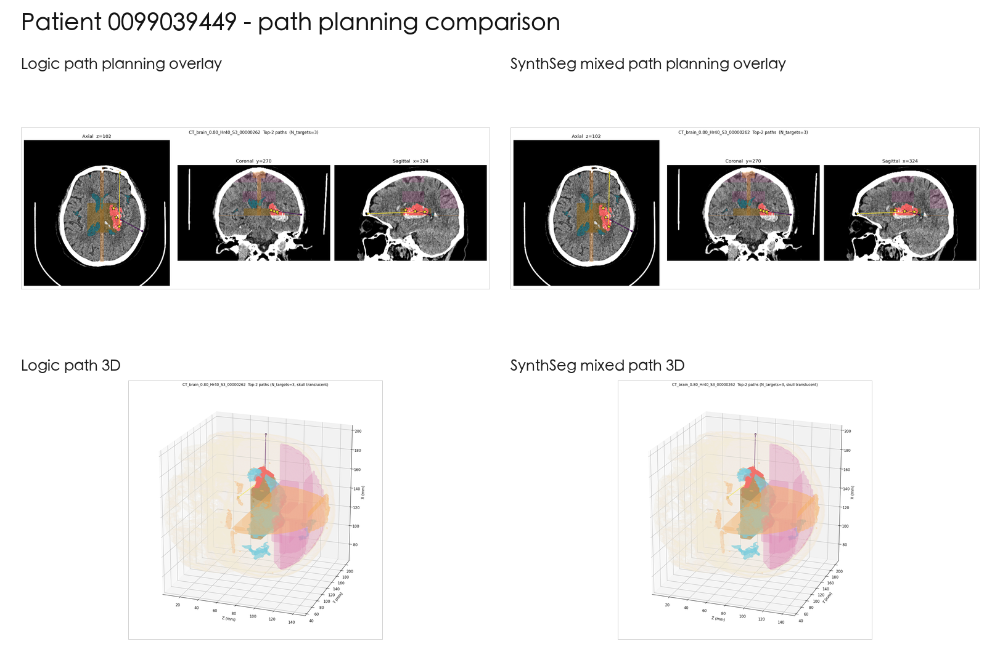
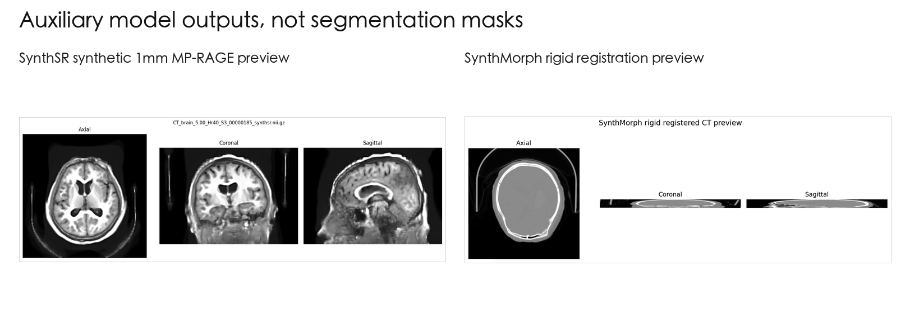

# 模型分割结果图文对比分析报告

记录日期：2026-06-23  
项目目录：`/Users/thy/Desktop/KeTiZu/proj_260608/Songtt_proj01`  
图像资产目录：`docs_thy/06_report_assets`  
PDF 文件：`docs_thy/06_模型分割结果图文对比分析报告.pdf`

## 1. 核心结论

当前项目实际可用数据为头颅 CT，不是 MRI。已有 DICOM 头信息统计为 `CT=1001`、`MR=0`、`UNKNOWN=2`，因此本报告只讨论当前 CT 数据上的分割结果。功能区、脑干、血管等在 CT 上存在天然限制，不能把当前结果理解为 MRI/fMRI/CTA 级别的精确分割。

当前最合理的方案是混合流程：CT 规则流程继续负责颅骨、颅腔、脑组织、血肿、血管风险区和功能区近似；SynthSeg Robust 优先用于脑室和脑干这类解剖结构；SynthSeg Standard 仅作为对照；SynthSeg Parc 作为后续皮层/功能区标签扩展候选；SynthSR 和 SynthMorph 是辅助预处理/配准能力，不直接参与分割 mask 质量排名。

## 2. 模型-步骤覆盖矩阵

| 分割/处理步骤 | CT 规则/Logic | SynthSeg Standard | SynthSeg Robust | SynthSeg Parc | SynthStrip | SynthSR | SynthMorph Rigid |
|---|---|---|---|---|---|---|---|
| 原始 CT 预览 | 有 | 不适用 | 不适用 | 不适用 | 不适用 | 不适用 | 不适用 |
| 颅骨分割 | 有结果，主流程采用 | 不适用 | 不适用 | 不适用 | 可做脑提取但本轮失败 | 不适用 | 不适用 |
| 颅腔/脑组织/血肿 | 有结果，主流程采用 | 不处理血肿 | 不处理血肿 | 不处理血肿 | 不适用 | 不适用 | 不适用 |
| 脑室分割 | 有 baseline | 有结果 | 有结果，推荐优先 | 009 有结果，与 standard 一致 | 不适用 | 不适用 | 不适用 |
| 血管风险区 | 有结果，当前为风险禁区 | 不适用 | 不适用 | 不适用 | 不适用 | 不适用 | 不适用 |
| 脑干分割 | 有几何禁区 | 有结果，但 010 明显失败 | 有结果，推荐优先 | 009 有结果，与 standard 一致 | 不适用 | 不适用 | 不适用 |
| 功能区近似 | 有几何近似 | 不直接输出功能区 | 不直接输出功能区 | 有皮层标签潜力，尚未映射 | 不适用 | 不适用 | 配准后可辅助 MRI/atlas 映射 |
| 路径规划 | 有结果 | 可影响脑室/脑干禁区 | 可影响脑室/脑干禁区 | 暂未接入路径 | 不适用 | 不适用 | 后续跨序列配准辅助 |
| 预处理/配准 | 不适用 | 不适用 | 不适用 | 不适用 | 失败 | 生成 synthetic 1mm MP-RAGE | 生成 rigid 配准结果 |

说明：不是每个模型都适合每个步骤。SynthSeg 系列是解剖标签模型，不做颅骨、血肿、血管风险区；SynthSR/SynthMorph 不是分割模型。

## 3. 两个病例的步骤总览

### 3.1 病例 0099039449：有血肿病例

该病例检出血肿 `8.37 mL`，血肿平均 HU `63.9`，solidity `0.637`。颅骨、脑组织、血肿、血管风险区和功能区由 CT 规则流程产生；当前目录中的脑室和脑干 overlay 是 SynthSeg 混合流程输出。路径规划已生成，Top-1 路径长度 `50.65 mm`，入颅角 `18.12°`。

### 3.2 病例 0100297683：无血肿病例

该病例颅腔体积 `1048.32 mL`，脑组织体积 `999.50 mL`，未检出满足阈值和形态学约束的血肿，因此没有路径规划目标。它对 SynthSeg standard/robust 的稳定性对比很有价值：standard 在脑干上明显失败，而 robust 恢复到可用范围。

## 4. 脑室分割对比

### 4.1 0099039449 脑室：logic vs standard vs robust vs parc

| 方法 | 脑室体积 | 与 logic 的 Dice | 说明 |
|---|---:|---:|---|
| Logic | `19.094 mL` | - | CT HU/距离骨板/连通域 baseline |
| SynthSeg Standard | `30.151 mL` | `0.673` | 覆盖更完整，体积更大 |
| SynthSeg Robust | `29.970 mL` | `0.659` | 与 standard 高度相近，Dice `0.890` |
| SynthSeg Parc | `30.151 mL` | `0.673` | 与 standard 完全一致，Dice `1.000` |

分析：SynthSeg 系列在该病例中更保守地覆盖脑室/CSF 区域，尤其 sagittal 面可见脑室连续性更完整。Logic 更依赖 CT 低密度阈值，范围较小。若路径规划目标是尽量避开完整脑室系统，SynthSeg/Robust 更适合作为禁区；若目标是严格保留 CT 上明显低密度区域，logic 更可解释。

### 4.2 0100297683 脑室：logic vs standard vs robust

| 方法 | 脑室体积 | 与 logic 的 Dice | 说明 |
|---|---:|---:|---|
| Logic | `40.285 mL` | - | baseline |
| SynthSeg Standard | `66.242 mL` | `0.707` | 体积明显大于 logic |
| SynthSeg Robust | `63.419 mL` | `0.715` | 与 standard 脑室 Dice `0.918` |

分析：该病例中 standard 与 robust 的脑室结果高度一致，说明脑室结构本身没有出现明显模型分歧。两者都比 logic 大，主要差异来自脑室边界和 CSF 连续区域是否纳入。

## 5. 脑干分割对比

### 5.1 0099039449 脑干：logic vs standard vs robust vs parc

| 方法 | 脑干体积 | 与 standard 的 Dice | 说明 |
|---|---:|---:|---|
| Logic | `20.889 mL` | `0.000` | 几何禁区，与解剖标签定义不同 |
| SynthSeg Standard | `20.855 mL` | - | 解剖标签 16 |
| SynthSeg Robust | `24.586 mL` | `0.901` | 与 standard 高度重叠，略大 |
| SynthSeg Parc | `20.855 mL` | `1.000` | 与 standard 一致 |

分析：Logic 脑干与 SynthSeg 脑干几乎不重叠，这不是单纯“谁错了”，而是定义不同。Logic 是路径规划中的下部中线保守禁区，SynthSeg 是解剖标签。后续路径规划可以把 robust 脑干作为解剖禁区，同时保留 logic 脑干作为保守安全备份。

### 5.2 0100297683 脑干：standard 失败，robust 恢复

| 方法 | 脑干体积 | QC brainstem | 说明 |
|---|---:|---:|---|
| Logic | `36.704 mL` | - | 几何禁区，偏保守 |
| SynthSeg Standard | mask `3.672 mL`，stats 最大连通域 `1.994 mL` | `0.0216` | 明显失败，碎片化 |
| SynthSeg Robust | mask `15.420 mL`，stats `15.415 mL` | `0.7530` | 输出连续，质量明显恢复 |

分析：这是本轮最关键的模型差异。Standard 的 QC 接近 0，脑干只剩少量碎片，不建议作为自动结果。Robust 在同一 CT 上恢复出连续脑干区域，QC 也回到可用区间。后续建议以 robust 为默认脑干模型，并设置 QC 门控。

## 6. 既有差异图复核

0099039449 的差异图显示：脑室中 SynthSeg-only 区域主要扩展在脑室边缘和连续 CSF 区；脑干中 SynthSeg-only 与 logic-only 几乎分离，进一步说明二者不是同一解剖定义。报告中的 Dice/Jaccard 应理解为模型间一致性，而不是医学真实准确率。

## 7. 血管风险区与功能区

血管风险区和功能区目前只有 CT 规则/几何流程结果，不是深度模型结果。平扫 CT 无法可靠分割未钙化血管，当前血管输出是风险禁区；功能区在 CT 上也无法精确分割，当前输出是运动、语言、视觉、深部核团的几何近似。

SynthSeg Parc 虽然可以输出更多皮层标签，但还没有建立 label 到“运动区/语言区/视觉区/深部核团”的可靠映射，因此暂不能替代功能区几何模块。

## 8. 路径规划对比

| 模式 | 入颅候选点 | 合法路径数 | Top-1 长度 | Top-1 入颅角 |
|---|---:|---:|---:|---:|
| Logic 对比流程 | `1500` | `2` | `50.65 mm` | `18.12°` |
| SynthSeg 混合流程 | `1500` | `2` | `50.65 mm` | `18.12°` |

0099039449 中，虽然脑室/脑干 mask 有差异，但最终 Top 路径没有改变。这说明该病例路径主要受血肿位置、颅骨厚度、血管风险区和入颅几何控制。不能据此推断所有病例都不受影响；当血肿更靠近脑室或脑干时，模型差异可能改变候选路径。

## 9. 辅助模型输出

SynthSR 成功生成 1mm synthetic MP-RAGE 风格体数据，但强度范围变成 `0-255`，不再是 HU，不能输入当前 HU 阈值分割。SynthMorph rigid 成功生成配准后体数据和 LTA 变换，适合后续 CT/CTA 或 CT/MRI 对齐，但它不直接产生分割 mask。

SynthStrip 两次推理被系统杀掉，退出码 `137`，当前环境下不纳入可用分割结果。

## 10. 最终建议

1. 当前默认方案建议采用“CT 规则流程 + SynthSeg Robust”的混合架构。
2. 颅骨、血肿、血管风险区、功能区继续用 CT 规则/几何流程。
3. 脑室和脑干优先使用 SynthSeg Robust，同时保留 logic 结果用于回退和人工复核。
4. SynthSeg Standard 不建议作为无 QC 的默认模型，0100297683 已出现严重失败。
5. SynthSeg Parc 先作为后续功能区标签扩展候选，不直接接入路径规划。
6. 对 SynthSeg 输出增加 QC 门控：brainstem QC < `0.50` 时不采用脑干结果；general CSF QC < `0.50` 时脑室结果需人工复核。
7. 后续如果加入 MRI/CTA，应优先使用 SynthMorph 做配准，再把 MRI/CTA 上更可靠的脑干、功能区、血管 mask 重采样回 CT 网格。
